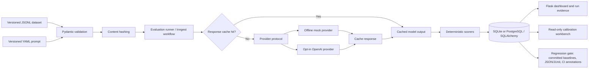
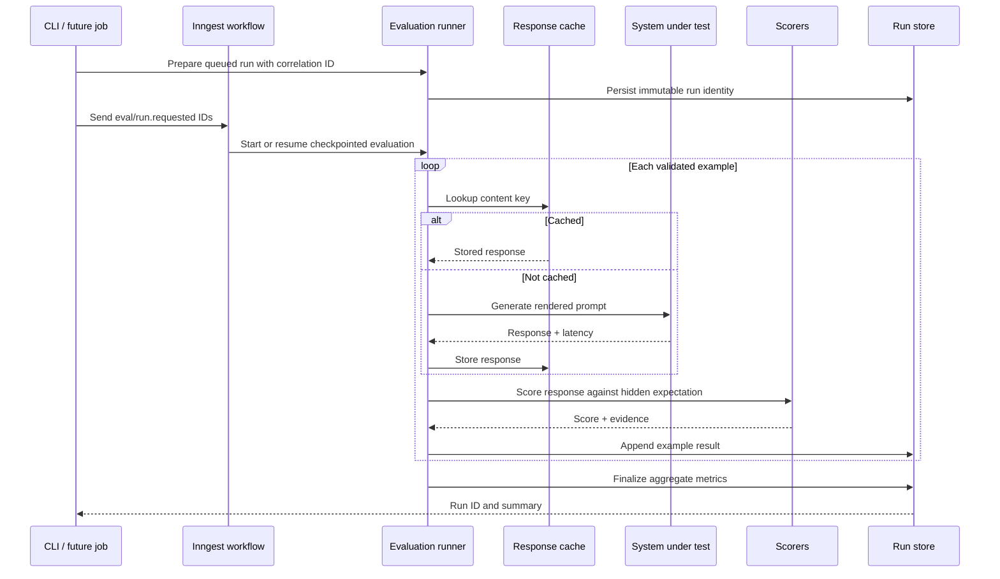
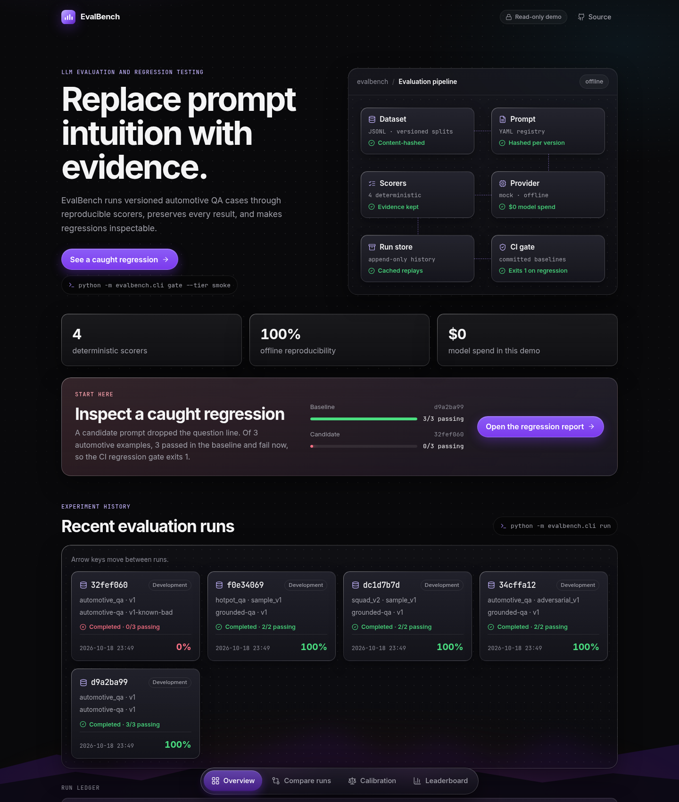
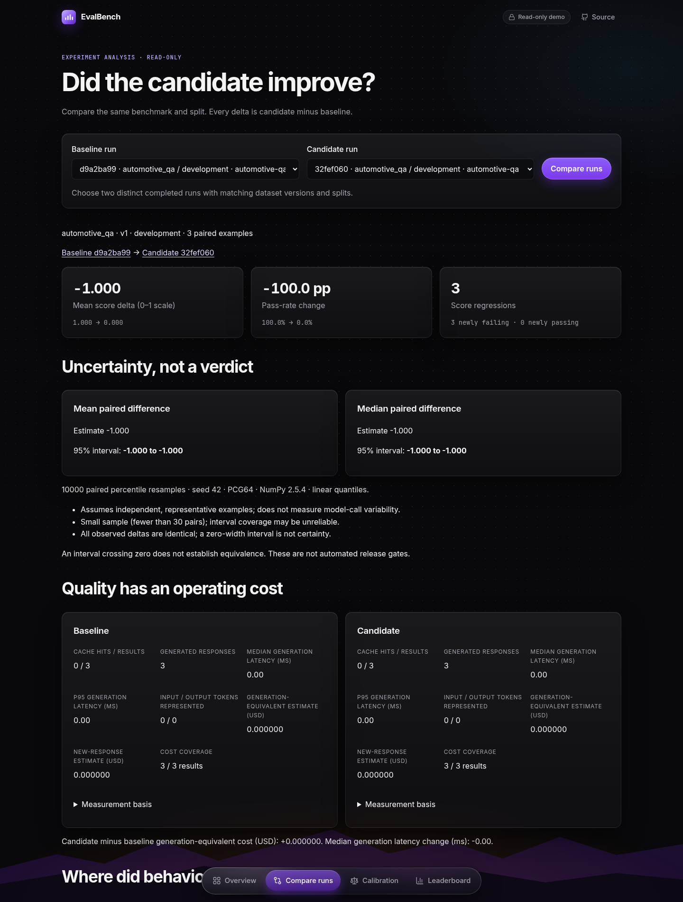
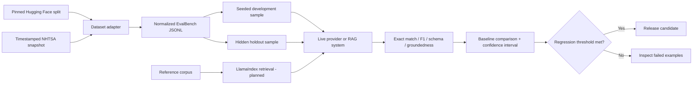

# EvalBench

**A reproducible LLM evaluation and regression platform for testing answer quality before model changes reach production.**


## Real-world problem

A customer-facing assistant fails on a particular question. It skips the passage that contains the answer, states a number the source does not support, or refuses when the manual has the fact. That shows up after a prompt edit, a model swap, or a retrieval change that looked fine in a chat window. A handful of successful demos leaves the release questions unanswered: did the fixed test set get better, which examples broke, and is the difference larger than noise?

EvalBench is the check that runs before that change ships. Questions, prompts, and scoring rules are versioned and content-hashed. Every run is append-only and keeps the per-example evidence. A candidate is paired with the baseline that already shipped. The CI gate fails the change when examples that passed now fail, and when the mean score drops past the configured tolerance and the paired bootstrap interval excludes zero. The same request is cached by content hash, so a repeated suite does not pay again for a generation it already stored. The public demo replays those saved runs and rejects writes, so a visitor can open a caught failure without a model API key.

The working domain is automotive question answering, a stand-in for a support bot that has to stay on a manual. The October 18, 2026 measurement uses the offline mock provider and the fixture set. It shows the harness catching a known-bad prompt. A live-model ranking, and a judge-versus-human reliability number, need studies this repository has not run.

## LinkedIn post

Copy the text below into LinkedIn. The first two lines are the fold. Every figure is from the October 18, 2026 mock-provider demo and the GitHub Actions gate run recorded in [docs/phase-7-portfolio.md](docs/phase-7-portfolio.md).

```text
A prompt change that looks fine in chat is how a wrong answer reaches a customer.

I built EvalBench, a regression harness for LLM prompts. It pins the questions, the prompt, and the scorer, stores every example, and fails CI when answers that used to pass now fail.

The demo case is automotive QA: a grounded reply a product chatbot owes a customer. Drop the question line from the prompt. On the offline mock provider, three development answers go from passing to failing, and the mean score moves from 1.000 to 0.000. GitHub Actions records the same three failures (auto-001, auto-002, auto-003) and a mean delta of -1.000. The read-only demo shows that comparison with no API key. Generation cost on the seed was $0.000000.

The release gate scores with those deterministic checks. A model judge joins the gate only with a passport: holdout agreement with people, stable repeats, order stability, and a verbosity check. The human side of that passport is still open. An October 13, 2026 session stored three assisted holdout labels. The workbench minimum is ten.

The fixtures show the harness on a small offline set. A live-model leaderboard would be a larger study, and this repository does not report one.

https://github.com/Sujay1709/evalbench-ai

#LLMOps #MLEngineering #Evaluation
```

EvalBench turns datasets, prompt versions, provider settings, and scoring rules into traceable evaluation runs. It stores per-example evidence, reuses identical responses through content-addressed caching, and makes regressions inspectable from a Flask dashboard.

The default evaluation path is deliberately offline and deterministic. It proves that the infrastructure works without API keys or paid model calls. Phase 2 added an opt-in OpenAI Responses API adapter, a reproducible Hugging Face importer, and pinned SQuAD v2 and HotpotQA samples. The adapter is contract-tested but has not been credentialed smoke-tested. Phase 4 added paired comparisons, bootstrap intervals, and cost/latency reporting. Phase 5 adds versioned judge evidence, blind human labels, split-safe agreement reports, an interactive calibration workbench, and opt-in pairwise order-swap judging; RAG and release-gate use of model judges remain planned work.

## Why this project exists

LLM demos often show a handful of successful answers but cannot answer the engineering questions that matter in production:

- Did a prompt or model change improve quality across a fixed test set?
- Can every score be traced to the exact dataset, prompt, provider, and configuration?
- Are repeated runs reproducible, cacheable, and inexpensive?
- Which examples regressed, and why did a scorer fail them?
- Can the same evaluation run in CI before a release?

EvalBench is designed around those questions. It emphasizes measurable behavior, immutable run history, explicit failure evidence, and honest separation between deterministic checks and model-based judgment.

## Verified capabilities

| Capability | Evidence in the current repository |
|---|---|
| Versioned evaluation data | Validated automotive JSONL examples with a dataset content hash |
| External dataset provenance | Eight SQuAD v2 and HotpotQA fixtures pinned to source rows and repository revisions |
| Versioned prompts | YAML prompt registry with variable validation and a prompt content hash |
| Provider abstraction | Offline mock plus an opt-in, contract-tested OpenAI Responses API adapter |
| Deterministic scoring | Exact match, token F1, answerability, and JSON Schema with readable evidence |
| Behavioral contracts | Automotive perturbation families report invariance violation and directional success from ordinary pass/fail bits; links stay inside one split |
| Evidence sensitivity | A development question family fails an evidence-insensitive answer and passes an evidence-responsive fixture, with a written reason for every variant |
| Judge release passport | A judge is refused by the regression gate until supplied holdout agreement, repeatability, order-swap, and verbosity sections pass; the shipped gate uses deterministic scores |
| Adaptive sampling audit | A seeded simulation records order, stop reason, intervals, calls, and cost, and reports saved calls only when the full suite agrees; the release gate still scores every example |
| Reproducibility | Dataset hashes and versioned prompt/provider identities are stored per run; cache keys hash the exact prompt, provider, dataset subset, and example |
| Response caching | Identical requests are served from a content-addressed SQLAlchemy cache |
| Audit trail | Append-only run summaries, per-example results, and persisted correlation IDs |
| Durable workflow execution | Inngest validation, generation, scoring, and atomic completion checkpoints with idempotent database replay protection |
| Safe failure finalization | Exhausted retries produce categorized, sanitized diagnostics while preserving completed runs and partial evidence |
| Judge calibration workbench | Explicit, split-safe judge/human evidence pairing with weighted-kappa, bootstrap uncertainty, confusion matrices, disagreement review, and same-request repeatability summaries |
| Web observability | Run dashboard, run-detail view, liveness, and database readiness routes |
| Database compatibility | SQLite offline default and Supabase/PostgreSQL via psycopg, verified hosted TLS, bounded pools, and migration compatibility tests |
| Local quality gate | Offline automated tests and Ruff static analysis; an opt-in local PostgreSQL service exercises migration and persistence compatibility |
| Regression gate | `evalbench gate` compares candidate runs with committed baselines under a versioned policy, writes JSON/JUnit reports, and exits 0/1/2; a known-bad prompt fixture fails it offline |

## Architecture pipeline



The Flask routes only handle HTTP concerns. Dataset loading, prompt rendering, providers, scoring, caching, and run orchestration live in framework-independent modules so they can also be used by the CLI, background jobs, and the CI regression gate.

## Evaluation workflow

### Compare completed runs (Phase 4)

The paired comparison engine reports candidate-minus-baseline score and pass-rate
changes, plus improved, regressed, unchanged, newly passing, and newly failing
examples. It reads existing results without generating responses or changing runs:

```python
from evalbench import create_app
from evalbench.comparisons import compare_runs
from evalbench.extensions import db
from evalbench.models import EvaluationRun

app = create_app()
with app.app_context():
    baseline = db.session.get(EvaluationRun, "<baseline-run-id>")
    candidate = db.session.get(EvaluationRun, "<candidate-run-id>")
    if baseline is None or candidate is None:
        raise ValueError("Choose two existing run IDs from the dashboard")
    comparison = compare_runs(baseline, candidate)
    print(comparison.mean_score_delta, comparison.newly_failing)
    for example in comparison.examples:
        if example.change == "regressed":
            print(example.example_id, example.score_delta)
```

Both runs must be completed and use the same dataset name, version, content hash,
and development/holdout split. Prompt and provider may differ. Results are paired
by example ID and returned in sorted order; incomplete coverage, inconsistent
aggregate metrics, and conflicting stored inputs raise `ComparisonError`.
Legacy mixed-split runs are excluded. Score changes and pass/fail transitions are
reported independently: a partial-credit improvement need not cross a passing threshold.
The read-only comparison dashboard is available at `/compare`.

### Calibrate a judge against human evidence (Phase 5)

Open `/calibration` and choose a completed development or holdout run. For each
result, select one completed judge attempt and one independently stored human
label. EvalBench validates that every selected pair belongs to that exact run and
split, uses the same versioned rubric, and shares one judge model/prompt
configuration. It then reports exact agreement, quadratic weighted kappa,
result-paired bootstrap uncertainty, criterion-level agreement, a score confusion
matrix, and a disagreement ledger.

The page is deliberately **read-only and advisory**: it makes no provider call,
does not modify run scores or evidence, and does not authorize a release. Mixed
historical runs cannot be selected. A defined report is evidence about the chosen
cohort—not proof that the judge is generally reliable. This is an interview-ready
example of separating model observability from model governance.

When the same result has multiple completed attempts under an identical judge
configuration and request hash, the workbench reports repeated-score agreement.
It also summarizes stored A/B and B/A pairwise attempts by preference-flip rate
and first-position win share. Repeated and pairwise judge commands each make
additional provider calls; these measurements show consistency and possible
position sensitivity, not correctness or causation.

Human labeling remains an interactive, blind CLI workflow. The command displays
the evidence and rubric anchors without showing deterministic or judge scores;
see [the labeling guide](docs/human-labels.md). There is intentionally no
browser-side label submission because the Jinja demo has no authentication
system. The current workbench provides read-only analysis. An authenticated
annotation UI belongs in the separate frontend/auth design.

For a release-readiness check, select a holdout run, pair its completed judge
attempts with independent human labels, build the report, then set minimum
sample, exact-agreement, and weighted-kappa lower-bound thresholds in the
**Holdout calibration readiness** panel. This opt-in check is read-only and
fails closed when the cohort is development-only, too small, or lacks a
bootstrap interval. Thresholds are operator policy, not empirically universal
defaults; a passing result is not a quality guarantee.

The separate
[`adversarial_v1.jsonl`](datasets/automotive_qa/adversarial_v1.jsonl) automotive
fixture covers prompt injection inside context, false premises, missing facts,
and conflicting evidence. It has two examples per split; development is the safe
default. These deterministic examples test expected behavior, not real-world
model robustness.

### Explore comparisons in the browser

Start Flask with `flask --app evalbench:create_app run --debug`, open
`http://127.0.0.1:5000/compare`, and select two completed runs. You can also use
the **Compare runs** link in the navigation. The page shows paired score and
pass-rate deltas, bootstrap intervals with limitations, tag/difficulty summaries,
and filters for improved, regressed, or unchanged examples. Open an example to
inspect both outputs and scorer evidence side by side. URLs preserve the run IDs
so comparisons and evidence can be bookmarked.

The pages make no model calls or database writes and also work in read-only demo
mode. Tag/difficulty summaries require the original dataset in the local registry;
if it is missing or changed, the page keeps paired results visible and explains
how to restore metadata. Dashboard bootstrap calculations are limited to 2–1,000
pairs; use the Python API for larger analyses. These pages do not authorize
deployment or claim statistical equivalence.

Manual UI check: select two compatible runs, filter **Regressed**, open a case,
and follow **Back to comparison**. Check keyboard focus, 375px and desktop layouts,
and long output wrapping. Automated route tests cover rendering and safe escaping;
browser-based visual/accessibility acceptance remains pending.

### Cost, latency, and leaderboard interpretation

Open `/leaderboard` to compare quality, cost, and generated-response latency only
within the exact same dataset name, version, content hash, and split. Run-detail
and comparison pages show the same recorded efficiency evidence. Median and P95
latency exclude cache-hit zeros; otherwise caching would make provider latency look
artificially fast. Small samples remain descriptive.

EvalBench reports **generation-equivalent cost** for all recorded responses and
**new-response cost** only for responses generated during that run. Estimates cover
successful stored responses; retries, discounts, and other provider fees may not be
represented. The pricing basis is displayed. Missing or invalid measurements are
shown as **Unknown**, never silently converted to zero.

The Pareto view marks a run dominated only when another compatible run has at least
as much quality and no more cost, with one strict improvement. Equal points can both
remain on the frontier. Unknown-cost runs stay in the table but are excluded from
Pareto classification. The SVG has an exact table alternative and uses marker shape
plus text, not color alone.

New runs snapshot provider token usage and configured estimates per result. Mock
runs record zero because they make no paid API call. OpenAI estimates are opt-in and
require both values below; copy pricing you intentionally choose rather than
assuming repository defaults are current:

```bash
OPENAI_INPUT_USD_PER_MILLION=<chosen-input-price>
OPENAI_OUTPUT_USD_PER_MILLION=<chosen-output-price>
```

Historical results remain append-only; their usage stays null and renders unknown.
Pricing affects future provider responses and is not a billing limit. The
regression gate can enforce optional P95 latency and estimated-cost budgets.

### Programmatic uncertainty

To estimate uncertainty across paired examples:

```python
from evalbench.comparisons import paired_bootstrap

intervals = paired_bootstrap(comparison, confidence_level=0.95, n_resamples=10_000, seed=42)
print(intervals.mean_delta)  # estimate, lower, upper
print(intervals.median_delta)  # median of per-example differences
print(intervals.warnings)
```

Each resample draws example pairs together with replacement. The report gives
percentile intervals for the mean and median of candidate-minus-baseline score
differences, along with sample size, confidence level, seed, resample count,
PCG64 generator, NumPy version, and linear quantile method. Repeating the same
inputs and settings in the same environment gives the same report, regardless
of example order. Resampling uses bounded batches to limit intermediate memory.

At least two pairs are required. Fewer than 30 pairs trigger an advisory, not a
guarantee that larger samples are sufficient. A constant observed difference
produces a zero-width interval with a warning. Our small fixtures validate the
implementation; they do not support reliable model-selection claims. The method
assumes independent, representative examples and does not capture repeated-call
model randomness or account for dependent question families. An interval crossing
zero does not establish equivalence. The regression gate below uses this interval
only together with a practical tolerance and a hard newly-failing check.

The implementation follows the [paired percentile bootstrap procedure](https://docs.scipy.org/doc/scipy/reference/generated/scipy.stats.bootstrap.html)
and uses [NumPy linear quantiles](https://numpy.org/doc/stable/reference/generated/numpy.quantile.html).
Options accept finite confidence levels strictly between 0 and 1, 100–100,000
resamples, and a nonnegative integer seed.

To inspect hidden regressions by tag and difficulty, supply the original dataset
used by the runs (inside the same app context as the comparison example above):

```python
from evalbench.comparisons import compare_segments
from evalbench.datasets import EvaluationSplit, load_jsonl

dataset = load_jsonl("datasets/automotive_qa/v1.jsonl").select_split(
    EvaluationSplit(baseline.dataset_split)
)
segments = compare_segments(baseline, candidate, dataset)
for segment in segments.tags + segments.difficulties:
    print(segment.dimension, segment.label, segment.sample_size,
          segment.mean_score_delta, segment.newly_failing, segment.example_ids)
```

The dataset name, version, selected split, recomputed content hash, and example
coverage must match the runs. If validation fails, restore the original dataset
artifact and select the recorded split; do not relabel historical results.
Reports are immutable and do not write to the database or call a model.

Each segment reports baseline/candidate mean scores and pass rates, their deltas,
score improvement/regression counts, pass/fail transitions, and sorted example IDs.
Tags overlap: a row contributes once to each distinct tag, so tag counts must not
be added together as a benchmark total. Untagged rows use `label=None`, distinct
from any literal tag. Difficulty groups partition the examples in easy/medium/hard
order; absent groups are omitted. Singleton groups are valid descriptive summaries.
These breakdowns are exploratory, not significance tests or release gates; many
small groups can make chance differences look important. Always inspect sample size
and the underlying examples before drawing conclusions.

### Gate a change against baselines (Phase 6)

```bash
python -m evalbench.cli gate --tier standard \
  --json-report reports/gate.json --junit-report reports/gate.xml
```

The gate runs each benchmark in the tier with the configured provider and
compares it with a committed baseline in `regression/baselines/<provider>/`.
Benchmarks, tiers (`smoke`, `standard`, `full`), and the policy live in
[`regression/gate.yaml`](regression/gate.yaml). A benchmark fails when any
example that passed in the baseline now fails, or when its mean score drops by
more than the tolerance and the paired bootstrap interval excludes zero. Exit
code 1 means a regression, and 2 means the gate could not be evaluated, such as
a stale baseline. In GitHub Actions it also prints `::error` annotations and a
step summary.

To try a prompt change, pass `--candidate-prompt BENCHMARK=PATH`. The committed
known-bad fixture fails the gate:

```bash
python -m evalbench.cli gate --tier standard --candidate-prompt \
  automotive-development=regression/fixtures/automotive_qa_missing_task.yaml
```

After an intended behavior change, `python -m evalbench.cli record-baseline`
rewrites the baselines; review that diff like code. Details, report formats, and
limits are in [docs/regression-gate.md](docs/regression-gate.md).

### Evaluation execution

1. **Load and validate** a pinned dataset and prompt definition.
2. **Hash the inputs** so a run can be reproduced and compared later.
3. **Render one prompt per example** using only declared template variables.
4. **Check the response cache** using the provider, prompt, example, and settings identity.
5. **Generate or retrieve a response** through the provider protocol.
6. **Apply compatible scorers** and capture human-readable evidence.
7. **Persist an append-only run** with per-example outputs, scores, latency, and cache status.
8. **Inspect failures** in the dashboard or compare the stored results programmatically.



## Repository layout

```text
evalbench/
├── datasets/                 # Automotive, SQuAD v2, and HotpotQA JSONL fixtures
├── prompts/                  # Versioned YAML prompt definitions
├── regression/               # Gate policy, tiers, committed baselines, known-bad fixture
├── evalbench/
│   ├── datasets/             # Validation, loading, and hashing
│   ├── gates/                # Baseline comparison policy and gate reports
│   ├── prompts/              # Prompt registry and rendering
│   ├── providers/            # Mock and opt-in OpenAI Responses adapters
│   ├── scorers/              # Exact match, token F1, answerability, and schema
│   ├── services/             # Evaluation orchestration
│   ├── templates/            # Dashboard and run-detail pages
│   ├── models.py             # Runs, results, and response cache
│   └── cli.py                # Reproducible command-line runner
├── migrations/               # Alembic database migrations
├── tests/                    # Unit and integration tests
├── Dockerfile                # Production container definition
├── plan.md                   # Phased implementation plan
└── Deploy.md                 # Deployment and inactivity strategy
```

## Quick start

Python 3.12 is the supported project runtime.

```bash
git clone https://github.com/Sujay1709/evalbench-ai.git
cd evalbench-ai
python3.12 -m venv .venv
source .venv/bin/activate
python -m pip install -r requirements-dev.txt
cp .env.example .env
flask --app evalbench:create_app db upgrade
pytest
python -m evalbench.cli run --split development
flask --app evalbench:create_app run --debug
```

Open [http://localhost:5000](http://localhost:5000) to inspect the run dashboard.

The deployed read-only demo is <https://evalbench-demo.onrender.com>. The caught
automotive regression is the page to send a recruiter:

<https://evalbench-demo.onrender.com/compare?baseline=ef236041-dab5-46eb-bb30-050af15fbf45&candidate=5e876498-a724-46f1-9940-f3061c443a63&change=regressed>

### Score a repository on a pull request

The public demo does not clone a visitor's repository or accept an upload. A
repository is scored by checking it out in GitHub Actions. Copy
[`.github/workflows/regression-gate.yml`](.github/workflows/regression-gate.yml)
into that repository with its datasets, prompts, and committed baselines. On a
pull request the gate compares the head branch with the baseline recorded from
the base branch and writes the dataset scores into the job summary and
`reports/gate.json`. The three ways to take that evaluation further are in
[docs/evaluating-further.md](docs/evaluating-further.md).

### Reproduce the public demo and smoke suite

The public demo is the same Flask app in read-only mode, seeded offline with the
mock provider. These commands reproduce it from a fresh clone with no API key and
no hosted database:

```bash
source .venv/bin/activate
python -m evalbench.cli gate --tier smoke
export DATABASE_URL=sqlite:///demo.db LLM_PROVIDER=mock  # instance/demo.db
python -m evalbench.cli demo-seed
APP_ENV=production DEMO_READ_ONLY=true MAX_RUN_COST_USD=0 \
  SECRET_KEY="$(openssl rand -hex 32)" \
  gunicorn --bind 127.0.0.1:8000 'evalbench:create_app()'
```

In a second terminal:

```bash
scripts/smoke_demo.sh http://127.0.0.1:8000
```

- `gate --tier smoke` is the CI smoke suite: it re-runs the smoke benchmarks and
  compares them with the committed baselines, exiting `0` when nothing regressed.
- `demo-seed` stores the standard-tier baseline runs plus a known-bad candidate
  prompt that drops the question line. Re-running it creates nothing new, and it
  refuses any provider other than `mock`.
- The home page's **Inspect a caught regression** link opens the comparison
  where that candidate turns three passing automotive answers into failures.
- In read-only mode every `POST`, `PUT`, `PATCH`, and `DELETE` returns `403`.
- A production read-only process refuses to start unless `LLM_PROVIDER=mock` and
  `MAX_RUN_COST_USD=0`. Behind Render it trusts one proxy hop, so HTTPS from
  `X-Forwarded-Proto` is the request scheme. Development ignores that header.

The October 18, 2026 local run of these commands is written up in
[docs/phase-7-portfolio.md](docs/phase-7-portfolio.md). The numbers there are
the mock provider and the fixture datasets. They are not a live-model benchmark.





The [`Dockerfile`](Dockerfile) runs the same seed before Gunicorn, and the
`Container smoke test` workflow builds it and runs `scripts/smoke_demo.sh`
against the container. [`render.yaml`](render.yaml) describes the Render
service; see [`Deploy.md`](Deploy.md) for the deployment procedure.

### Persistent PostgreSQL / Supabase

Supabase can persist evaluation history and cached responses outside an ephemeral
backend filesystem. Flask, SQLAlchemy, and Alembic remain in place; SQLite still
works without an account. Hosted connections use certificate/hostname verification
and bounded pools. PostgreSQL runs require explicit migrations and never create
tables automatically. No hosted database has been provisioned by this integration.

See [the secure Supabase setup and migration-test guide](docs/supabase-database.md)
for certificate configuration, migration/runtime role separation, Data API
protection, local PostgreSQL testing, and the required hosted smoke check.

The approved [React/shadcn migration](docs/frontend-migration.md) lives in
`frontend/` and is served at `/app/` only when `FRONTEND_ENABLED=true`. Jinja
remains the default UI until comparison, calibration, and leaderboard pages
reach documented parity. shadcn was initialized only inside `frontend/`.

### Health checks

```bash
curl --fail http://localhost:5000/health
curl --fail http://localhost:5000/health/ready
```

- `/health` confirms that the web process is alive.
- `/health/ready` also verifies that the database is reachable and, in read-only
  demo mode, that the seeded demo runs exist; otherwise it returns `503`.

### Reproducibility and cache check

```bash
python -m evalbench.cli run --split development
python -m evalbench.cli run --split development
```

The first run generates deterministic offline responses. The second run should mark every response as coming from the cache while producing the same scores and content hashes.

### Durable workflow with the local Inngest Dev Server

The durable path uses the same offline mock provider but runs each side effect in a separately memoized Inngest checkpoint. No Inngest Cloud account or API key is required.

Start Flask in the first terminal:

```bash
source .venv/bin/activate
INNGEST_DEV=1 flask --app evalbench:create_app run --debug --port 5000
```

Start the Dev Server in the second terminal:

```bash
npx --ignore-scripts=false inngest-cli@latest dev \
  --no-discovery \
  -u http://127.0.0.1:5000/api/inngest
```

Open [http://localhost:8288](http://localhost:8288). In a third terminal, explicitly sync the SDK endpoint and then queue an offline development run:

```bash
curl --fail --request PUT http://127.0.0.1:5000/api/inngest
source .venv/bin/activate
INNGEST_DEV=1 python -m evalbench.cli queue --split development
```

The sync response should include `"ok": true`, and the Dev Server should show the `evalbench-eval-run` function. The queue command prints the EvalBench run ID, correlation ID, and Inngest event ID. Use those identifiers to connect the database record, run-detail page, and Dev Server trace.

To inspect recovery behavior without paid calls, open the completed trace, select a `generate-response-*` step, and choose **Rerun from step**. Inngest restores earlier checkpoint outputs; EvalBench's response cache and idempotent result writes prevent duplicate provider calls and rows. The offline acceptance test also injects a deterministic interruption after the first generation checkpoint and verifies that the resumed workflow finishes with exactly three provider calls, three cache entries, and three unique results.

If event dispatch fails, the queued run is retained. Retry safely with the correlation ID printed by the command:

```bash
INNGEST_DEV=1 python -m evalbench.cli queue \
  --split development \
  --correlation-id <CORRELATION_ID>
```

### Optional live-provider run

Set the following values only in the untracked local `.env` file:

```dotenv
LLM_PROVIDER=openai
OPENAI_API_KEY=replace-with-a-local-development-key
OPENAI_MODEL=gpt-5.6-luna
OPENAI_TIMEOUT_SECONDS=30
OPENAI_MAX_RETRIES=2
OPENAI_MAX_OUTPUT_TOKENS=128
# Optional; configure both from the pricing source and date you intentionally choose.
# OPENAI_INPUT_USD_PER_MILLION=<chosen-input-price>
# OPENAI_OUTPUT_USD_PER_MILLION=<chosen-output-price>
```

Then run one of the pinned samples:

```bash
python -m evalbench.cli run \
  --dataset datasets/squad_v2/sample_v1.jsonl \
  --prompt prompts/grounded_qa/v1.yaml \
  --split development
```

This is an opt-in paid integration. The public demo must keep `LLM_PROVIDER=mock`, and the live command should only be run after confirming the selected model, account access, and cost budget.

## What has actually been tested

The following checks were most recently run locally on September 1, 2026:

| Check | Result |
|---|---|
| `pytest` | 96 tests passed |
| `ruff check .` | Passed |
| Database migration | Upgrade completed and all three application tables were created |
| Development CLI evaluation | 3 of 3 deterministic fixtures passed; all responses generated |
| Repeated development evaluation | 3 of 3 passed with identical metrics; all responses served from cache |
| Holdout CLI evaluation | 2 of 2 deterministic fixtures passed after explicit split selection |
| Flask dashboard | Homepage and run-detail evidence rendered successfully |
| Health routes | Liveness and database readiness returned successful responses |
| Durable recovery | An interrupted checkpoint resumed without duplicate provider calls, cache entries, or result rows |
| Inngest Dev Server | Local function registration, event dispatch, completed trace, and step rerun verified with the offline provider |

The 100% fixture result validates the mechanics of the runner and scorers. It is **not** presented as evidence that a real LLM has perfect automotive knowledge.

## Evaluation data contract

Each JSONL record is one independent test case. This example follows the implemented Pydantic schema:

```json
{
  "id": "auto-001",
  "input": {
    "question": "What does ICE stand for in an automotive powertrain?",
    "response_format": "Return only the expanded term."
  },
  "mock_response": "internal combustion engine",
  "scorers": [
    {
      "type": "exact_match",
      "expected": "Internal Combustion Engine"
    }
  ],
  "tags": ["powertrain", "terminology"],
  "difficulty": "easy",
  "split": "development"
}
```

Dataset and prompt hashes change when their content changes. That means two runs should only be compared as the same benchmark when the recorded identities match—or when the difference is intentional and documented.

## Real-world evaluation strategy

Yes, EvalBench can be tested with Hugging Face datasets and live reference data. Small SQuAD v2 and HotpotQA fixtures are now checked in with typed provenance; bulk loading should still happen through explicit dataset adapters rather than passing an arbitrary dataset directly to the LLM. See [`datasets/README.md`](datasets/README.md) for exact commands and sampling limitations.

### Recommended benchmark ladder

| Source | What it tests | Proposed EvalBench use |
|---|---|---|
| [SQuAD v2](https://huggingface.co/datasets/rajpurkar/squad_v2) | Grounded extractive QA plus questions with no answer in the supplied context | Four-row fixture plus a revision-pinned streamed importer |
| [HotpotQA](https://huggingface.co/datasets/hotpotqa/hotpot_qa) | Multi-hop reasoning across multiple context passages with supporting facts | Four-row fixture plus a revision-pinned `distractor` importer |
| [NHTSA vPIC](https://vpic.nhtsa.dot.gov/api/Home/Index) | Live automotive manufacturer, model, VIN, and vehicle specification data | Create timestamped domain regression cases and test freshness, normalization, and API-failure handling |
| Curated automotive holdout | Portfolio-specific questions reviewed against authoritative sources | Measure domain accuracy and regression behavior without benchmark contamination |

Hugging Face supports streamed dataset loading, so an adapter can sample examples without downloading an entire corpus. For reproducibility, EvalBench should pin the dataset name, configuration, split, revision, sampling seed, and selected example IDs; the normalized JSONL artifact should then be content-hashed and stored with the run metadata.

### Benchmark answers are not reference context

This distinction prevents evaluation leakage:

| Data element | May the model see it? | Purpose |
|---|---:|---|
| User question | Yes | Input to the system under test |
| Approved context or retrieved documents | Yes | Evidence the model is allowed to use |
| Gold answer / expected JSON | **No** | Hidden answer key used only by scorers |
| Scorer thresholds and private labels | Normally no | Evaluation policy, not generation context |
| Public system instructions | Yes | Defines the task and response contract |

Putting the expected answer into the prompt would test copying, not reasoning or retrieval. For RAG evaluation, EvalBench should index a separate reference corpus, retrieve top-k passages, pass those passages to the model, and keep the gold answer isolated in the evaluator. The run should record retrieved document IDs so groundedness and citation quality can be audited.

### Development and holdout policy

Every evaluation run selects exactly one split. `development` is the default for prompt iteration, while `holdout` must be requested explicitly for milestone evaluation:

```bash
python -m evalbench.cli run --split development
python -m evalbench.cli run --split holdout
```

Mixed-split runs are rejected before a provider call or database write. Each selected subset receives its own content hash, and the chosen split is persisted with the run. Historical runs created before this policy are labeled `legacy_mixed` rather than being misrepresented as leakage-safe runs.

### Proposed live-test pipeline



### Five stages before calling it production evidence

1. **Sample validation — complete:** map small pinned SQuAD v2 and HotpotQA samples into EvalBench, record provenance, and test the normalized examples. A streamed CLI importer now reproduces larger seeded samples from pinned revisions.
2. **Scorer validation — complete:** token F1 and answerability cover punctuation, aliases, partial overlap, empty answers, and explicit abstention.
3. **Live provider adapter — contract complete:** the Responses API adapter has bounded SDK retries, timeout/error classification, token metadata, and cache-safe model identity. A credentialed smoke test and multi-model comparison remain.
4. **RAG evaluation:** use LlamaIndex only as the retrieval layer, log retrieved evidence, and score both final answers and retrieval quality.
5. **Statistical regression gate:** compare against a stored baseline using paired examples and uncertainty estimates; fail CI only when a documented threshold is crossed.

This staged approach keeps the current offline suite fast and free while adding a separate opt-in integration suite for network-dependent and paid tests.

## Scoring philosophy

EvalBench uses deterministic scoring whenever a property can be checked directly:

- **Exact match:** suitable for normalized labels and short canonical facts.
- **JSON Schema:** verifies parseability, required fields, types, and structural contracts.
- **Token F1:** gives partial credit for overlapping answer spans, supports aliases, and records precision and recall evidence.
- **Answerability:** measures whether a model answers or correctly abstains when context lacks an answer.
- **Retrieval metrics — planned:** evaluates whether the right supporting passages were retrieved.
- **LLM judge — later phase:** reserved for subjective qualities and calibrated against human labels before being trusted.

Model-based judges are useful but not ground truth. Their prompt, model version, and variance must be tracked like any other system under test.

## Research foundations

EvalBench uses evaluation research as design input, not as evidence that a planned feature already works. The papers below motivate concrete additions to the roadmap while preserving the project's rule that benchmark claims require reproducible experiments.

- **Holistic evaluation:** [HELM](https://arxiv.org/abs/2211.09110) argues for evaluating models across explicit scenarios and multiple metrics while retaining raw prompts and completions for transparency. EvalBench applies this through versioned datasets, provider identities, content hashes, per-example evidence, and the planned comparison dashboard; robustness, calibration, efficiency, and fairness slices remain future work.
- **Behavioral testing:** [CheckList](https://aclanthology.org/2020.acl-main.442/) organizes tests around capabilities and minimum-functionality, invariance, and directional-expectation cases. EvalBench applies that structure to linked automotive families: meaning-preserving perturbations keep the answer, and evidence-changing perturbations revise it or abstain. The reported rates check those fixture contracts.
- **Rubric-based LLM judges:** [G-Eval](https://aclanthology.org/2023.emnlp-main.153/) reports stronger human alignment from structured evaluation criteria and reasoning steps, but also identifies evaluator bias toward LLM-generated text. EvalBench will therefore version judge rubrics and structured outputs, then calibrate them against human labels instead of treating judge scores as ground truth.
- **Judge bias auditing:** [MT-Bench and Chatbot Arena](https://proceedings.neurips.cc/paper_files/paper/2023/hash/91f18a1287b398d378ef22505bf41832-Abstract-Datasets_and_Benchmarks.html) document position, verbosity, self-enhancement, and reasoning limitations in LLM judges. Planned pairwise evaluation will swap answer order, preserve both decisions, measure flip rates, and route disagreements for human review.
- **RAG component evaluation:** [RAGAS](https://aclanthology.org/2024.eacl-demo.16/) separates retrieval quality, faithful use of context, and generation quality. [ARES](https://aclanthology.org/2024.naacl-long.20/) adds context relevance, answer faithfulness, answer relevance, and calibration using a small human-labeled set. EvalBench will keep retrieval metrics separate from final-answer metrics and store the retrieved evidence IDs needed to audit both.
- **Prompt robustness:** [PromptBench](https://arxiv.org/abs/2306.04528) evaluates character-, word-, sentence-, and semantic-level prompt perturbations. This motivates a deterministic perturbation registry and a prompt-degradation report rather than assuming one prompt template represents stable model behavior.
- **Adaptive evaluation budgets:** [Leveraging computerized adaptive testing for cost-effective evaluation of large language models in medical benchmarking](https://www.nature.com/articles/s41746-026-02671-w) studies precision-driven variable-length evaluation instead of testing every item equally. EvalBench audits that idea on seeded paired simulations: an early stop also has to cover every tag and difficulty, and saved calls are withheld when the full suite disagrees. The release gate still scores every example.

### Research-backed portfolio experiments

These concepts are **new to EvalBench and intentionally uncommon as a combined portfolio workflow**. They should not be described as globally unprecedented without a formal systematic literature and prior-art review.

1. **Behavioral Contract Compiler:** implemented for the offline automotive fixture. Typed links record minimum-functionality, invariance, and directional relationships. Invariance violation rate and directional success rate are computed from ordinary pass/fail outcomes, so exact match, token F1, answerability, and schema scores stay in place. The checked-in family is [`datasets/automotive_qa/behavioral_v1.jsonl`](datasets/automotive_qa/behavioral_v1.jsonl). This is a deterministic contract test of fixture answers, not a measured model-robustness result.
2. **Causal Evidence Sensitivity Lab:** implemented for one offline development question family, [`datasets/automotive_qa/sensitivity_v1.json`](datasets/automotive_qa/sensitivity_v1.json). The same question is scored with supported, evidence-removed, value-swapped, and contradictory contexts. Each variant records the evidence IDs that changed and whether the expected behavior is answer preservation, answer revision, or abstention. The sensitivity scorer explains every pass or failure. A system that always repeats the supported answer fails, including when exact match would still accept that answer on the supported variant. A fixture that follows the evidence passes. This checks the scorer. It is not a measured model result.
3. **Judge Reliability Passport:** implemented as a release-gate check on supplied evidence. The report names the judge and versioned rubric and includes repeated-run agreement, holdout order-flip rate, holdout human agreement with its confusion matrix and weighted-kappa interval, and a verbosity probe. Deterministic scorers stay authoritative. A judge cannot participate in `evalbench gate` unless every section passes, and the shipped gate declares no judge. The automated tests use mocked ratings and a synthetic readiness report. They do not measure a judge against a human-reviewed holdout, so no judge is authorized to gate a release.
4. **Confidence-Budgeted Regression Sampler:** implemented as an offline simulation. The schedule scores hard examples, then each tag, then example id. It can stop only after every tag and difficulty has its minimum coverage and the paired mean-delta interval is beyond a documented minimum detectable effect. Saved calls are reported only when that decision matches the full suite. When the replay disagrees, no savings are reported. `evalbench gate` still scores every configured example. The costs in the audit are inputs to the simulation, not measured API spend.

The implementation order and commit boundaries for these experiments are recorded in `plan.md`. The four experiments above are covered by offline tests. Adaptive sampling is not enabled in the regression gate. A measured judge-human kappa is still not a verified capability.

## Deployment status

| Target | Status | Notes |
|---|---|---|
| Local CLI | **Verified** | Migrations, evaluation, persistence, and cache replay pass locally |
| Local Flask dashboard | **Verified** | Run summaries, per-example evidence, and health routes render locally |
| Docker | **CI smoke-tested** | The `Container smoke test` workflow builds the image, starts it on a non-default `PORT`, and runs `scripts/smoke_demo.sh` |
| Render | **Not deployed** | `render.yaml` is ready; the service has not been created. Procedure and inactivity mitigation are in `Deploy.md` |
| External uptime monitor | **Not configured** | `/health` is ready for a permitted monitoring service |
| Inngest background jobs | **Locally verified** | The Dev Server registers the workflow, accepts queued events, displays traces, and reruns checkpointed work without duplicate application records |
| Public portfolio demo | **Implemented, not yet hosted** | Read-only seeded mode with a featured regression; reproducible locally with the commands above |

The deploy status is intentionally explicit: a Dockerfile or deployment document is not the same as a verified public deployment.

## Reliability, cost, and security controls

- Secrets belong in environment variables and `.env` is excluded from Git.
- Offline tests require no provider credentials and incur no model cost.
- Content-addressed caching prevents identical live requests from being billed twice.
- Historical evaluation runs are append-only for auditability.
- A public demo must never expose an unauthenticated paid generation endpoint.
- The Inngest endpoint is omitted from read-only demos and rejects unsigned production invocations and synchronization requests.
- The OpenAI adapter uses timeouts, bounded SDK retries, failure classification, `store=False`, and token-usage metadata.
- External dataset terms, licenses, revisions, and provenance should be recorded before redistribution.

## Roadmap

- [x] **Phase 0:** Flask foundation, typed settings, persistence, migrations, health checks, and tests
- [x] **Phase 1:** versioned automotive data, prompt registry, provider protocol, deterministic scoring, persisted runs, and response caching
- [x] **Phase 2:** HF samples, QA scorers, the streamed importer, split enforcement, and the opt-in provider adapter; a credentialed provider smoke test remains optional
- [x] **Phase 3:** secured Inngest workflows with idempotent validation, generation, scoring, completion/failure handling, local traces, and interruption-recovery acceptance coverage
- [x] **Phase 4:** implementation merged in PR #20; keyboard, mobile/desktop,
  leaderboard, drill-down, and read-only browser acceptance recorded in
  [docs/phase-4-acceptance.md](docs/phase-4-acceptance.md)
- [x] **Infrastructure interlude:** secure Supabase/PostgreSQL integration merged in PR #21; hosted smoke verification remains operator-run
- [x] **Phase 5 implementation:** [versioned rubric and opt-in judge execution](docs/judge-contracts.md), [blind human labels](docs/human-labels.md), optional local Kev evidence, split-safe agreement reporting, repeated-score summaries, pairwise order-swap display, adversarial automotive fixtures, and a configurable holdout readiness check. Browser-side annotation remains deferred until authentication/CSRF support exists. The reliability claim is still open. An October 13, 2026 local SQLite session stored three assisted holdout labels (both SQuAD v2 sample holdout rows and one of two HotpotQA sample holdout rows) with no paired judge attempts. The workbench default minimum is 10 labeled results.
- [x] **Phase 6:** [regression gate](docs/regression-gate.md) accepted on October 18, 2026. [Run 39176061699](https://github.com/Sujay1709/evalbench-ai/actions/runs/39176061699) passed the standard tier, showed `::error` annotations for the known-bad automotive prompt (`auto-001`, `auto-002`, `auto-003`, mean delta -1.000), and uploaded `regression-gate-reports`. Baselines remain mock-only.
- [ ] **Phase 7:** read-only seeded demo, demo-aware readiness, security headers, a featured-regression entry point, a non-root Docker image, `render.yaml`, and a container smoke test in CI are implemented. [Measured notes and screenshots](docs/phase-7-portfolio.md) record the October 18, 2026 local mock demo. Completion still needs a live Render deploy that passes `scripts/smoke_demo.sh`.

See [`plan.md`](plan.md) for completion criteria and [`Deploy.md`](Deploy.md) for the deployment design.

## Known limitations

- The default provider is deterministic and offline; the OpenAI adapter is contract-tested but has not yet been credentialed smoke-tested.
- The repository contains five automotive fixtures and eight external sample fixtures, which are appropriate for infrastructure verification but too small for model selection.
- Exact match, token F1, answerability, and JSON Schema are implemented; retrieval and citation metrics remain planned.
- The Docker image is smoke-tested in GitHub Actions ([container run 39175853230](https://github.com/Sujay1709/evalbench-ai/actions/runs/39175853230)). A live Render service has not been created, so no public URL has passed `scripts/smoke_demo.sh`.
- Regression baselines exist only for the offline mock provider, so the gate catches prompt and pipeline regressions, not live-model drift. With two or three examples per benchmark, the newly-failing check does most of the work; the interval rarely excludes zero at this size.
- Comparison, cost-reporting, and calibration-report mechanics are verified offline; no live-model performance benchmark or generalizable human-calibrated judge claim is made yet. The October 13, 2026 labels are a local workflow check on three fixture rows, stored only in the operator's SQLite database.

These are roadmap boundaries, not hidden caveats. Each one maps to a testable milestone above.

## Engineering story

EvalBench demonstrates more than API integration: it shows dataset design, experiment reproducibility, provider abstraction, deterministic testing, persistence, caching, observability, and production-aware deployment planning. The strongest interview discussion is the decision to validate the evaluation harness offline first, then add model-judgment evidence behind explicit human calibration, uncertainty, and disagreement review rather than treating an LLM score as ground truth. The measured recruiter, resume, and technical lines for the seeded demo are in [docs/phase-7-portfolio.md](docs/phase-7-portfolio.md).
